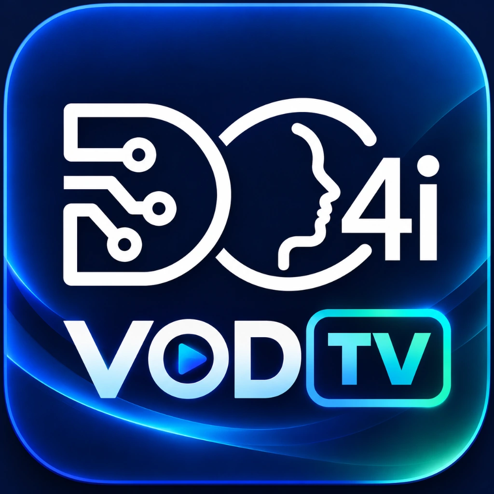

# DC4I LG webOS Homebrew Repository

Canonical TV repository: https://lg.darc.dev/

Homebrew Channel expects JSON at the root URL. A browser-friendly project page is at https://lg.darc.dev/about.html.

## DC4I VOD TV 1.2.19

- Identifier: com.dc4i.vodtv (new package identity, remove com.dc4i.boringtv before installing)
- Market: Poland (PL), interface: Polish-first
- Neon artwork: generated for this product, retained in assets/brand/DC4I_VOD_TV_Neon_Approved_2026-10-24.png
- Migration 1.1.x to 1.2.0: uninstall old app ID com.dc4i.boringtv, then install new com.dc4i.vodtv
- Artwork: the user-approved DC4I VOD TV neon application logo
- TMDB v3: bundled and tested, no TV setup
- YouTube Trending: disabled until Google YouTube Data API v3 credentials become available
- Package (Cloudflare Pages): https://lg.darc.dev/packages/com.dc4i.vodtv_1.2.19_all.ipk
- SHA256: 56bd89f3444524e4b08566a8e17128314286da9d2d432d8f6e928f8b7dfc8e0a

Package and catalog are deployed on Cloudflare Pages. The binary is intentionally **not committed to GitHub** as it embeds a client-side TMDB key. Anyone downloading the public IPK can extract that client key, so usage must be monitored and the key rotated if misused.

This personalized build is derived from the upstream project [theboringhumane/theboringtv-lgwebos](https://github.com/theboringhumane/theboringtv-lgwebos). It is not endorsed by LG or TMDB.

Reproducible preparation: build_dc4i.py (base), build_vod_tv.py (PL/EN and neon), scripts/neon_brand_v120.py (product branding), test_vod_tv.py, publish_vod_tv.py. They read a privately stored keys.js and do not write secrets to git-tracked plaintext files.

To release changes, build the app IPK, run test_vod_tv.py, run publish_vod_tv.py, and deploy dist via Cloudflare Pages. Test Homebrew and app startup on a real LG webOS TV before claiming end-to-end compatibility.

## Multiplatform webOS repository

- Browser interface: https://lg.darc.dev/browse/
- Homebrew Channel feed: https://lg.darc.dev/ (JSON for TVs) or https://lg.darc.dev/api/apps.json
- DStore import and operational details: docs/DSTORE-CATALOG.md

## Version history and known issues

- [Changelog](CHANGELOG.md) and [Polish changelog](docs/pl/CHANGELOG.md)
- [Delivery evidence](DELIVERY.md) and [Project charter](PROJECT.md)
- Stremio and IPTV Smarters handoff needs real LG TV validation.

## Native Stremio and IPTV Smarters Player (1.2.1)

- Verified LG OLED55G42LW IPTVSmartersPlayer app ID: `com.smarterstvplayers.net`; Pro is a different application.
- Stremio: best-effort TMDB/IMDb link handoff, platform support unverified.
- Smarters: experimental search-title hint, normal app launch if ignored.
- [Integration details](docs/NATIVE-PLAYER-INTEGRATION.md) / [Instrukcja po polsku](docs/pl/NATIVE-PLAYER-INTEGRATION.md).

## Smarters Player and Stremio Web (v1.2.2)

- Verified internal LG launch ID `com.smarterstvplayers.net` from the real TV; LG Store catalog number 1231221 is not a launch ID.
- Native Stremio and Smarters app title handoff is best-effort; Stremio Web offers a separate official browser fallback for the selected title.
- Details: [Native Player Integration](docs/NATIVE-PLAYER-INTEGRATION.md) / [Polski](docs/pl/NATIVE-PLAYER-INTEGRATION.md).

## LG TV screenshot atlas and repeatable capture

The [LG TV capture runbook](docs/LG-TV-CAPTURE.md) and its [Polish version](docs/pl/LG-TV-CAPTURE.md) describe the executable capture, session, review and atlas tools in `scripts/lg-tv/`. The [evidence method](docs/LG-TV-EVIDENCE-METHOD.md) records the observed native application IDs and separates physical-TV evidence from offline validation. Private screenshots, pairing configuration and account data stay outside this public repository.
